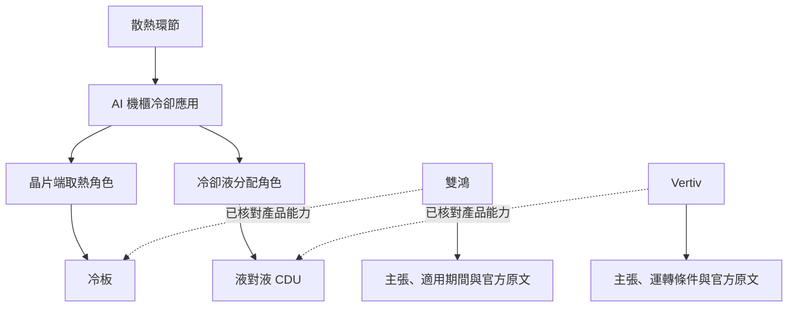

# 產業研究與既有地圖的操作關係

2026-10-16 核對於隔離預覽 `http://127.0.0.1:3014`。本文件分開記錄已實作的入口與 task 6.1 尚待交付的完整導覽，避免將資料關聯誤認為跨頁操作已全部串接。

## 各自回答的問題

既有地圖從環節與題材解釋產業位置、上下游及影響傳導；新版研究進一步回答應用需要什麼產品、各供應角色交付什麼、哪些公司有產品證據，以及採用條件與判斷界線。兩者是同一研究脈絡的不同閱讀層次。

首條已建立的分類與能力關係如下。分類線是索引，產品能力線不能推成公司間交易：

## 現在可以怎麼走

| 入口或動作 | 現在的行為 |
|---|---|
| [既有產業地圖](http://127.0.0.1:3014/) | 維持原有環節圖、題材、事件及公司定位入口；舊地圖尚未增加新版研究連結 |
| [首條液冷研究](http://127.0.0.1:3014/next) | 預設冷板；可切換液對液 CDU，閱讀交付範圍、條件、公司及來源 |
| 新版關係圖或下方文字清單 | 選取節點會切換對應研究，包含應用、角色、產品、公司及環節；不需只能操作圖形 |
| 新版公司索引／搜尋 | 可由公司名稱、別名或代號進入研究；95 家公司保留基本角色，首條流程僅深入核對雙鴻與 Vertiv 的產品範圍 |
| 新版「分享這份研究」及瀏覽器返回 | URL 帶目前選取與研究版本，新版內切換不混入另一版分類或引用 |
| 新版頁尾「既有產業地圖、事件與財務」 | 回到 `/` 首頁；尚未自動定位回剛讀的散熱或公司，也沒有保留跨頁來處 |

新版研究本身可由冷板經相鄰節點走回晶片端取熱、AI 機櫃冷卻及散熱；也可由雙鴻直接回到其產品或散熱分類。這會開啟新版的環節研究，而非自動切換舊版總圖。

## 完整操作方向（尚待 task 6.1）

1. 從產業總圖選「散熱」，在同一研究脈絡進入應用、供應角色與產品。
2. 選冷板或 CDU，閱讀產品邊界、條件及有證據的公司；由公司再比較其他產品角色。
3. 選主張旁的原文查證；圖形與文字入口應提供相同路徑。
4. 回到相應環節、題材或原地圖選取，接續上下游與其他環節探索，避免每次返回首頁重新尋找。

此方向落實既有 spec 的應用／角色／產品／公司導覽及 URL 返回要求；目前未完成跨頁的選取保留與雙向入口，不將本文件當作已實作證據。

## 資料怎麼連在一起

研究以 Git 中的 Markdown／YAML 維護。既有 17 環節、7 題材與 95 家公司經編譯成為新版研究快照，再補入應用、角色、產品、術語、主張與引用。公司用穩定身分對應舊代號，例如 `3324.TW` 對應同一家雙鴻；同名不會直接合併不同主體。

新版每次閱讀固定一個已發布版本，因此同頁的圖、公司、產品與來源可互相對照。既有地圖目前仍走舊 API，這不代表新舊 UI 已共用所有即時狀態。事件與財務另有資料時點，也不能由研究版本推定已重新抓取。

已以實際 API 核對上述五層相鄰節點、公司代號解析，以及 `/`、`/next` HTTP 200；本輪未改動閱讀 UI 或資料發布版本。
