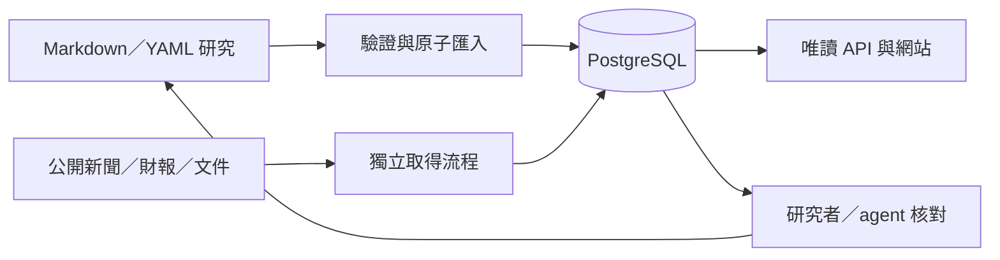

# Design

## Context

動機與優先順序見 [proposal.md](proposal.md)。本設計以 `b613d53` 為程式基準，現況與提案區分如下：

| 狀態 | 已觀察事實與設計意義 |
|---|---|
| well-supported | `graph.py::industry_graph` 由 `downstream` 建立所有邊，一律回傳 `kind=supply`；Markdown 已說明 `datacenter → compute` 是需求回饋。需補結構語意，不移除回路。 |
| well-supported | `Network.tsx` 目前只有 node tap；`Explorer.tsx` 已有 URL 選取、文字清單、手機局部圖與 resize 保留視角。連線操作應沿用這些機制。 |
| well-supported | `Assessment.tsx`、`Indicators.tsx`、版本差異與 breadcrumb 仍顯示部分原始代碼、數值及英文程度；`Status.tsx` 直接呈現錯誤字串。 |
| well-supported | `useApi` 每個 hook 自行 fetch 並使用 no-store；題材頁立即掛載 `AssessmentHistory`，進而取得版本與差異。 |
| well-supported | `coverage` 先載入全部事件及分類再逐項計算；`candidate_events` 全量取得候選後在 Python 截取；`latest_observations` 全量載入修訂後去重；`updates_payload` 重複組裝完整判讀與指標。 |
| well-supported | 五個優先環節已有產品與傳導解說；本 change 深化技術條件與引用定位，不重建整份地圖。來源註冊表目前沒有獨立技術文件類型。 |
| needs verification | 尚無這次 10 位讀取者的基準量測，也尚未核讀候選技術文件全文；不得據此聲稱現有容量或條文已驗證。 |

前一 change `add-evidence-based-theme-assessments` 已完成但未歸檔，其新增的 `theme-assessments`、`theme-indicators`、`theme-watchlist` 尚不在主 specs。本 change 對既有 capability 使用獨立 ADDED requirements，避免覆蓋前一 change 尚待同步的 MODIFIED blocks；不另建同名能力，也不在本輪歸檔或 sync。

## Goals / Non-Goals

**Goals:**

- 以 additive metadata 與投影連接圖形、技術論述、文件版本及研究缺口，保留 Markdown 的離線使用能力。
- 以一套顯示與讀取機制服務全站，避免每個頁面各自翻譯、格式化或保存不同的快取快照。
- 先建立相同環境、相同快照的效能基準，再修改查詢與讀取流程；容量主張限於實測條件。

**Non-Goals:**

- 不變更 17 環節的切分、公司正規 ticker、題材生命週期或三類關注更新的語意。
- 不把文件監測變成自動研究改寫、AI 摘要、客戶交易驗證或規格合規認證服務。
- 不引入 Redis、Neo4j、微服務或付費資料；來源門檻沿用免費公開且不需私有憑證的限制。

## Decisions

### 研究以文字檔編輯，網站以資料庫讀取

Markdown 適合作為目前個人及小群研究的編輯來源：正文承載推理，YAML frontmatter 承載可驗證結構，Git 保存修改原因與可審閱差異。它本身不保證證據正確；validator 也只檢查結構，來源內容與論述仍須研究核對。

研究的 authoring source 是 repo；PostgreSQL 保存網站可讀的研究投影、歷史快照與動態資料。網站不在每次請求解析 Markdown，也不提供另一個可以單獨改研究內容的 DB 寫入入口。需要修正研究時回到原檔，通過驗證再匯入；失敗則保留上次有效投影。重建研究投影不能取代動態資料與歷史的 DB 備份。

例如液冷文件發布新版，取得流程只保存觀測與待核對候選；維護者確認材料相容性或採用條件是否改變，再修訂 Markdown、日期及原因，匯入後網站才顯示更新的研究。核對是研究步驟，可由 agent 在使用者授權範圍內查證及編修，不額外要求每筆修改都由使用者點選批准；排程本身不自動改結論。

取捨是多人編輯可能有 Git 衝突、結構化欄位過多會降低可讀性，且缺乏即時網頁編輯。保留精簡的 frontmatter、穩定引用及單一 schema，避免正文與欄位重複保存同一論述。若未來需要多人同時編輯、細緻審核權限或大量逐筆更新，另提 change 將研究 authoring 移至 DB 與編輯介面；屆時 Markdown 可成為匯出格式，不能維持兩個可獨立編輯的權威來源。

### 1. 將顯示語意集中，原值保留為可核對資訊

在 frontend 共用顯示模組集中環節／題材／來源名稱、狀態與 confidence 對照；confidence 使用 specs 規定的三句中文。一般畫面保留有辨識價值的 ticker、正式技術名稱與必要原文；移除內部 ID、原始狀態及診斷的通用揭露元件。找不到名稱時呈現「名稱待補」等明確說明，原值保留在唯讀 API 及本機維護流程，避免空白或誤配。

數值格式化接收原始字串、單位、幣別與 scope；顯示萬／億等合適尺度，精確原值以數值的 title／無障礙名稱及期別修訂明細保留，不為每個數字增設展開列。比較運算仍由 backend Decimal 與既有口徑規則負責，不拿格式化後的值運算，不自動換幣。百分比與百分點、零與未知值分別處理。版本差異套用相同顯示器；版本差異只呈現有意義的欄位內容；識別引用本身的變更以引用調整說明，原定位碼留在 API。Markdown 的代碼與來源網址不能以全域字串取代破壞，相關敘述在研究編修時改用中文名稱。

API 保留可機器解析的原始狀態，UI 僅顯示中文取得說明與重試，診斷留在 API／服務紀錄。重試保留；API 故障不清除仍可使用的研究區塊。

替代方案：只改各頁文案容易漂移；改寫 API 原始列舉會影響舊客戶端與測試，因此採顯示層共用對照。

### 2. 保留拓樸，為每條下游邊增加一份權威說明

`upstream`／`downstream` 仍是拓樸與三種遍歷的權威，兩側必須一致。新增 optional `downstream-relations`，以 target ID 為鍵，只放在宣告下游的 source 檔：

- `kind`：`supply` 或 `demand-feedback`。
- `summary`、`items`、`dependencies`、`conditions`：中文說明；需求回饋的 items 說明需求形成機制，不虛構供應商品。
- `confidence`、`evidence`、`gaps`：支持程度、可解析引用及具體缺口。

validator 檢查 target 已在 downstream、型別合法、引用可解析且說明無重複；上游檔不再複製整份說明。舊格式沒有 metadata 仍合法，讀取時標示 `unreviewed`，不能推定為已核對供應。正式交付矩陣要求現有全部邊完成型別與說明或明確證據缺口。

graph API 保留 `id=source:target`、source、target、direction，擴充 kind 與解說 payload；kind 本來是字串，新增需求回饋與尚未核對值。公司關係圖使用原交易關係型別，不套用環節型別。環節詳情增加相同關係資料供文字清單使用。`impact_paths` 的上下游、題材、手足機制與 visited 防回路規則不因型別重寫；結構候選仍與具條件的傳導假設分開。

連線選取使用既有 URL 加 `relation=<source:target>`，保留 layer／segment；不合法或不在目前圖中的 relation 顯示找不到關係並提供清除操作。圖與文字清單共用 selection；文字清單提供可鍵盤啟動、關閉後焦點返回。圖以線型、圖例與文字區分型別，保留 viewport，不在每次選取時重建完整 Cytoscape instance。

替代方案：移除回饋邊會破壞既有案例；把型別寫兩份會增加漂移；另建圖資料庫不適合目前規模。

### 3. 技術研究與文件基準仍由 repo 維護

新增 optional `technical-profile` 供環節及題材使用，包含 `product-boundary`、`adoption-conditions`、`bottlenecks`、`substitution-limits`、`claims`、`evidence-gaps` 與 `reviewed`。claims 有穩定 ID、statement、confidence、來源及必要定位資訊；已支援的題材 assessment 論點可直接被引用，不複製成另一套互相矛盾的結論。

來源入口只放在 `sources.yaml`；新增 `global` 市場與 `technical-documents` 類型。文件的已核對基準放在 `industry-map/technical-documents.yaml`，紀錄 document ID、source ID、標題、機構、文件性質、版本標籤或未知、精確文件位址、發布精度、查核日期、適用範圍及必要摘錄定位。這是文件與人工核對 manifest，不另存一份來源註冊表。新 YAML 鍵與識別碼採英文 kebab-case，投影至既有 Python／SQL／API 命名時明確轉換。

文件性質採 `formal-specification`、`draft`、`roadmap`、`vendor-explanation`、`informative`；其與人工 review state、runtime 健康、confidence 分開。舊版引用在 repo 保留，研究引用 document ID 與穩定 version ID，不能默默指向「最新」文件。

匯入時先驗證整份地圖、來源及文件引用，再於單一 transaction 投影。舊檔缺少新欄位仍合法；若新 manifest 存在，所有新引用必須解析。驗證器測試沿用合法基準加單點失敗案例。唯一 schema 同步記錄欄位、跨檔引用、未知日期與舊格式範例。

題材判讀已有版本，不新增第二套判讀歷史。採納文件若改變原 assessment，照既有 change_reason／semantic hash 建立版本；只增加技術面向或記錄「不影響原結論」時，不宣稱原判讀有新版本。技術面向與文件核對時間獨立可見。

替代方案：只在散文貼來源無法精確追蹤版本；將全文與動態資料塞回 frontmatter 會失去靜態研究邊界，因此只保存必要引用與研究基準。

### 4. 文件觀測使用 additive tables，核對從本機 manifest 匯入

新增三類資料：

| 投影 | 責任 |
|---|---|
| 文件定義 | 穩定 document ID、source ID、scope 與已核對 manifest；不存在於新版 manifest 時保留歷史引用。 |
| 文件內容觀測 | append-only 的明確版號、正規化主體摘要 hash、原始位址、發布精度、取得時間、必要摘錄與解析版本；同內容冪等。 |
| 核對紀錄／候選 | 對應前後觀測，狀態為待核對、已採納或核對後不影響研究；紀錄查核日及原因，由 manifest 匯入。 |

已核對版本與新觀測並列。新增只讀 `/api/technical-documents` 與 `/{id}`，列表及觀測歷史有明確 limit／offset／total；環節、題材及 coverage 回應增加文件與技術研究欄位。Next.js proxy allowlist 納入新資源。沒有公開 review 寫入 endpoint；維護者編修 manifest 與 Markdown，再透過 initialize／本機匯入流程更新。

Prefect 沿用現有 worker、來源失敗隔離及 advisory lock；技術監測預設每日一次，由 hourly flow 檢查到期時間，不啟動第二套互相競爭的排程。先為 OCP／OIF 可直接讀取且版號可辨認的指定文件建立小量自動監測；其餘逐入口採人工核對或已驗證的同類 adapter，明示方式，不承諾五家全文皆能自動取得。

每來源預設最多 2 個索引頁、10 份明列文件；HTML 上限 2 MiB、文件上限 15 MiB、單次 HTTP timeout 20 秒，所有上限可由註冊設定縮小。只追官方來源宣告的位址，不廣泛爬站、不登入或自動送申請表。採既有 HTML 解析工具；若 PDF 文字解析需要新依賴，僅加入鎖定版本的 pypdf。影像文件與不可可靠抽取內容回報人工核對限制，不新增 OCR 服務。

原始 bytes／ETag 可做傳輸快取，不能單獨證明內容有新版本。抽取文件主體並正規化換行、空白及版面雜訊；以 document ID、官方版本標籤及主體 hash 建立唯一觀測。索引頁只比較指定文件連結與版號，不 hash 整頁導覽。明確新版或主體實質差異進入候選；同位址無版號的內容差異標為「內容變動待檢視」，不合成官方版號。解析失敗只記操作狀態，不生成空文件或候選。解析器升版先以同一份原始內容核對，不能把演算法差異當新文件。

初次匯入只保存目前已核對基準，沒有較早歷史；第一次取得無已核對基準的文件列為待核對。403／404／timeout／登入頁不覆寫最後有效觀測。儲存必要摘錄、hash 及定位，全文僅按來源允許作本機取得或暫存，不把第三方全文重新公開。文件候選僅保留於 API 與維護報告，一般研究頁與 coverage 不展示監測清單、待核對數或觀測歷史；不新增第四類 watchlist token，也不改變三類既有 token。

替代方案：按 bytes 變化直接通知容易出現假更新；將候選自動納入研究會混淆證據與結論；在每次 API 讀取時抓外部文件會讓閱讀受來源故障牽連。

### 5. 五個優先環節先完成有來源的技術問題，再覆蓋全圖

每個技術問題都用「可確認的論述／成立條件／證據定位／未解缺口」交付，優先研究清單如下。此表是研究問題，並非本輪已確認的技術結論。

| 環節 | 必須釐清的研究面向 |
|---|---|
| thermal | 冷板、歧管、CDU 與設施水路責任；流量、壓降、熱交換、材料相容與維修條件；不同冷卻路線的採用限制。 |
| power | PSU、power shelf、DC/DC、BBU 與 UPS 邊界；架構轉換、負載瞬變、安全及認證條件；價值量如何移轉。 |
| interconnect | 高速電氣、流體、電力及機構子角色；損耗／距離、插拔與可靠度的適用條件，避免 rail 混義及錯配供應商。 |
| networking | scale-up／scale-out／跨機房、ASIC／DSP／模組／系統界線；銅、可插拔、LPO、CPO 的功耗、距離、測試及維修取捨。 |
| advanced-packaging | 中介層、載板、D2D 與 HBM 介面層次；良率、測試、互通性及產能限制；晶圓／面板與玻璃方案的替代條件。 |

其後完成 compute、memory、pcb、substrate、odm、datacenter、materials、equipment、foundry、test、eda-ip、power-discrete，共 12 環節；逐一回寫相連的 7 題材引用及限制。公司仍以 ticker 與特定供應角色核對；同一環節不代表所有子角色可互替。全圖矩陣要求每個面向有可回溯內容或具體缺口，不能只用「待研究」佔位。

以下為 2026-10-15 本輪核對的官方入口；只核對索引／介紹，未讀其全部規格全文，apply 時才逐文件確認版號、章節、可讀性及可引用範圍：

| 官方入口 | 本輪可支持的範圍／實作策略 |
|---|---|
| [OCP Cold Plate](https://www.opencompute.org/projects/cooling-environments/cold-plate/)／[Rack & Power](https://www.opencompute.org/projects/rack-and-power/) | Cold Plate 頁列出 accepted contributions 與冷板、迴路、快接頭等文件；逐文件區分採納規範及指南。選少量明確文件監測，不推定整站皆是正式規範。 |
| [OIF Implementation Agreements](https://www.oiforum.com/technical-work/implementation-agreements-ias/) | 官方頁區分 IA 及 informative documents，並列 CEI／CMIS 等版本。先以官方連結、版號及文件內容辨認，不能把 framework 或白皮書當成同層規範。 |
| [UCIe Specifications](https://www.uciexpress.org/specifications) | 公開介紹可讀，全文連結標示 REQUEST；本輪未取得全文，不送出申請、不宣稱已讀。先保留公開介紹及全文取得缺口。 |
| [IEEE IRDS](https://irds.ieee.org/) | 官方介紹把 IRDS 定義為技術預測與 roadmap；按實際 edition／chapter 建檔，不將預測當成強制規範或量產承諾。 |
| [JEDEC](https://www.jedec.org/) | 公開首頁有文件搜尋入口，但本輪標準文件頁存取受阻；每份文件的公開摘要／全文範圍仍待核對，不推定全部免費可下載或已讀。 |

### 6. 合併重複請求、延後歷史，快取只設在明確的一層

在既有 useApi 內建立應用層共用的請求 registry，key 包含完整路徑與正規化 query。相同請求的訂閱者共享 in-flight promise；只有最後一位訂閱者離開時才取消，保留目前防止舊回應覆蓋新選取的 key 檢查。錯誤不存入成功資料快取，retry 強制重新取得且讓訂閱者共享新結果。

題材頁保留既有讀取 endpoint，不引入包羅所有歷史的大型新 API。AssessmentHistory 只有展開才掛載；URL 指定版本比較則自動開啟。先讀小頁版本清單，選到特定兩版才讀 diff；單一初始版本不發無意義的自我比較請求。`/api/segments` 的名稱對照由相同 registry 共用。

| 資源 | 應用層策略 |
|---|---|
| industries、segments 清單、graph、研究詳情、已保存的特定版本 | 成功資料 TTL 最多 60 秒，手動重新取得略過。 |
| coverage 與文件列表／摘要 | TTL 30 秒；保留 as_of，手動重新取得略過。 |
| assessment 動態候選、indicators、sources、theme-updates、文件監測診斷 | 不保存跨讀取結果，只合併同時請求。 |

Next.js proxy 與 backend 初期維持 no-store，不再疊第二層 TTL；避免兩層相加超出新鮮度契約。共用 registry 設有界 LRU，最多 100 個已完成資源，無訂閱者才能淘汰。TTL 使用取得時刻計時，不因每次命中延長。已讀仍使用使用者顯示快照的 token，不能以背景新回應代標已讀。

替代方案：全站長時間快取會遮蔽失敗與更新；直接引入 Redis 或整套資料框架增加維護面，本階段先在既有 hook 內做可測的共用讀取。

### 7. SQL 聚合及排名取代逐筆掃描，保留 token 與分類定義

- coverage：以 EventSegment／EventTheme 分別 group by，使用 count distinct 與日期／分類條件算 30／90 日、背景、未知日期；公司提及使用既有 mentioned 語意的 SQL EXISTS／JSON 展開，例行財報依原歸屬計數。每組前三筆樣本採 window rank，僅為樣本載入 payload。所有摘要使用相同 reference，並在一致讀取快照中執行，避免 ingestion 中途提交導致計數與樣本不一致。
- assessment：以 SQL COUNT 分開已知日／未知日候選，SQL LIMIT 取前八筆；台北查核日界線、非例行、直接分類、published lifecycle、未來排除沿用既有契約。不能用取得時間推定新舊。
- indicators：先用 window rank 取得每個 identity 最新修訂，再套 period 排序及 12 筆預設限制（既有上限 36）；失效修訂仍阻止退回舊有效值。詳細修訂另提供有 total／offset／limit 的讀取，UI 可載入更多，不無聲截斷歷史。
- theme-updates：專用批次摘要查詢取代完整 assessment／indicators 組裝，重用同一輪候選與觀測集合；只取得計數、摘要與 token 必需欄位。token 必須保留既有 canonical 語意，不能因換演算法就全數顯示新更新；計算 token 的完整集合不能套 UI 樣本 limit。
- 避免每題材重讀來源 YAML 及重複查 Source／最新版本；在單次 request 內共用已載入結果。以 PostgreSQL EXPLAIN ANALYZE 選擇必要複合索引，索引與新文件表使用 additive migration。

SQL tests 對照固定 reference 的原查詢結果，並使用較多歷史、修訂、同時更新及未知日期案例檢查語意；SQLite 支援 unit tests，PostgreSQL 獨立環境確認 JSON／timezone／query plan。不能只依測試環境 SQL 語法通過就宣稱 production 成立。

替代方案：只快取現有全量掃描會保留資料成長瓶頸；先加硬體無法解決重複與無界查詢。

### 8. 先建立基準，再用相同條件驗收

在隔離還原 DB 與 production build 執行，正式 DB 不載入負載測試資料、不重置服務。實作開始先保存效能 baseline；改善後用相同資料快照、服務資源與 workload 重跑。記錄 CPU／RAM、OS／Docker、服務版本與 worker／連線池、資料表筆數、快照識別、網路路徑與快取設定。

改善前只量測已存在的 endpoint；新增文件摘要在 baseline 標為 N/A，實作後獨立套用相同併發與延遲目標，不將原本的 404 當成效能基準。固定查詢分布依 endpoint 類別計數，各類至少 100 筆樣本，並遍及現有環節／題材 ID；新增資源分開報告，不改變既有 endpoint 前後比較的 workload。

10 位虛擬讀取者持續發出 GET，不執行外部來源更新；暖機 60 秒、正式量測至少 5 分鐘。測試經網站同網域 `/api` proxy；直接 backend 的 query／HTTP timing 作瓶頸診斷，不能替代完整路徑。每位依固定循環讀 graph、segment、theme、assessment、indicators、theme-updates、coverage，覆蓋 17 環節／7 題材；文件摘要另依相同條件測試，各類正式樣本不足則延長時段。

每個常用 endpoint 分別驗收 p95 < 500ms，coverage 摘要分別驗收 p95 < 1 秒，非預期 HTTP／timeout／內容錯誤為零。另記冷讀、p50／p99、throughput、回應大小與 SQL 次數；不能以全體平均取代慢 endpoint。測試一般頁面、按需歷史與全圖鍵盤／手機流程時另記請求數，證明初次閱讀不預取歷史，請求共用沒有取消其他訂閱者。

先測正常讀取，再以隔離來源失敗、兩次相同 ingestion、同時匯入與讀取、API／worker／DB 重啟驗證退化與冪等。未達標即保留失敗紀錄與任務未完成狀態，量測指出的基礎設施擴充留待另提 change，不能在本 change 偷加 Redis／微服務。

## Risks / Trade-offs

- [公開文件的存取與授權限制] → 逐入口記錄已讀範圍，人工來源可合法保留；索引可讀不當成全文已核對。
- [版面或解析器變動造成假更新] → 保留抽取版本、正規化主體、冪等鍵與必要原始定位；不確定時列解析限制，不能自動生成新正式版。
- [補強研究範圍大] → 五個優先環節先完成，再逐批補其餘 12 環節及 7 題材；逐列矩陣接受具體缺口，不接受虛構證據或泛泛佔位。
- [SQL 最佳化改變計數／修訂／token] → 固定 reference 與 snapshot 比較舊新結果，保留 pending change 的回歸案例，在 PostgreSQL 驗證。
- [共享請求與快取造成舊資料或取消傳染] → 訂閱計數、資源 key、TTL／LRU、強制重試及已讀快照測試；不疊 server TTL。
- [效能量測受主機背景負載影響] → 保留資源及 workload 條件、比較相同快照，單獨報告冷暖與每個 endpoint；目標不擴張成一般容量保證。
- [未歸檔 change 的需求順序] → 前一 change 先歸檔，本 change 後歸檔；本輪只新增規劃 artifacts。

## Migration Plan

1. apply 起始確認前置 change 狀態與 b613d53 後續差異，保存隔離 baseline；備份 app DB，記錄事件／財報／觀測／判讀版本及 token。
2. 先交付共用閱讀語意與按需歷史；加入 optional schema、validator、關係說明與技術 manifest。先在副本驗證，非法匯入不得部分寫入。
3. 在空 DB 與還原 DB 驗證 additive migration、文件投影及只讀 API；既有識別與歷史不刪除。initialize 加入文件 manifest 匯入，來源觀測仍由獨立 worker 執行。
4. 先核對五個優先環節，再補其他環節與七題材；完成關係詳情、來源／文件／coverage 呈現，逐一保存真實取得限制。
5. 改善 SQL 與讀取 registry 後，跑離線測試、production build、Playwright、PostgreSQL 整合、兩輪更新與重啟驗證，再比較效能與全圖矩陣。
6. 回滾以停用文件監測及回復前一 app image／研究 commit 為主，保留 additive tables 與歷史；不直接 downgrade 刪新資料。有必要還原時使用獨立 DB，核對後切換設定，不覆寫原 DB。清除前端快取或重新整理後仍可讀舊格式。

## 2026-10-16 預覽回饋修正：以閱讀任務安排內容

實際預覽顯示，新增技術欄位插在供需及傳導之前，與原文重複；通用「進階資訊」打斷閱讀，文件待核對只是維護狀態，不能幫助讀者理解產業。使用者要求重新 review 並直接修正，本節取代前述將內部資料對一般使用者展開的設計。

- 沿用原版色彩與字體，不以更換外觀作為閱讀改善。環節先顯示原定義，再分「產業角色／技術與限制／追蹤重點」；角色含供需、傳導與代表公司，技術含原理解說、導入條件與替代限制，追蹤含指標、風險、題材與事件。
- 題材分「研究判讀／技術與供應鏈／數據與追蹤」。預設先讀結論、正反證據、成立條件與下一確認點；技術背景與數據各自閱讀，里程碑計畫和核對結果合併為一份。
- 分頁支援滑鼠、鍵盤左右鍵／Home／End；hash 可分享與直接開啟，既有 #assessment／#versions／#indicators／#candidates 深連結自動選到對應分頁。歷史仍按需載入。
- 移除全站「進階資訊」、原始診斷、逐事件識別碼、原始 JSON、來源設定等揭露。保留必要的數值、原幣、期間、不可比較原因、來源摘錄與不確定性。
- 移除環節、題材及覆蓋頁的「技術文件與待核對」。技術引用跟隨論述，使用者開啟來源時才載入指定版本／章節的摘錄、正式文件名稱及引用範圍；不讀監測列表。既有引用 URL 繼續提供文件摘錄，不呈現觀測／人工核對工作佇列。
- 驗收以讀者能完成的操作為準：快速找到角色與傳導、切換技術並追溯來源、由分享網址開到數據、不被維護資訊干擾。自動測試與桌機／手機畫面檢視分開記錄；不以通過測試替代使用者對易讀性的判斷。
